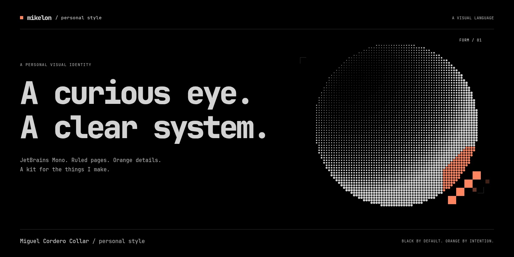
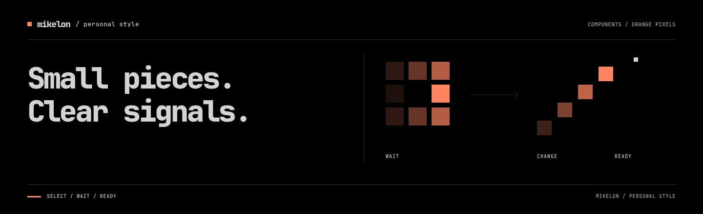
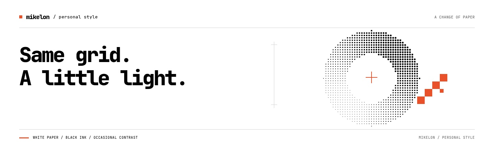
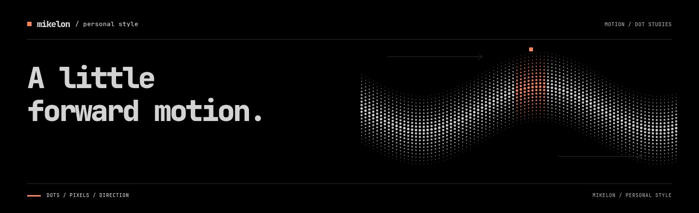

# Miguel personal style

JetBrains Mono. Black paper, pale ink, a little orange. A reusable visual kit for Miguel Cordero Collar's web interfaces, graphics, slides and motion.



[Explore the skill](skills/miguel-personal-style/SKILL.md) · [Usage and examples](skills/miguel-personal-style/references/usage.md) · [Visual rules](skills/miguel-personal-style/references/style-guide.md) · [Sources and attribution](skills/miguel-personal-style/references/source-record.md)

The kit includes restrained interaction motion for action presses, dialogs, toasts, loading feedback, first-item states, notices and disclosures. It also includes one-time editorial reveals, graphic-form transitions, copy confirmation and smooth determinate progress. Keyboard navigation and readable data stay immediate. See the [motion guide](skills/miguel-personal-style/references/ui-motion.md) for the reusable API and recipes.

## Install the skill

Install into the current project, choosing your agent when prompted:

```bash
npx skills add miguelcorderocollar/miguel-personal-style --skill miguel-personal-style
```

Install for your agent across projects:

```bash
npx skills add miguelcorderocollar/miguel-personal-style --skill miguel-personal-style --global
```

Target a harness explicitly, for example Codex or Claude Code:

```bash
npx skills add miguelcorderocollar/miguel-personal-style --skill miguel-personal-style --agent codex
npx skills add miguelcorderocollar/miguel-personal-style --skill miguel-personal-style --agent claude-code --global
```

The default scope is the current project; `--global` uses the agent's user-level skills location. Omit `--agent` for the interactive agent picker. Node.js and npm are required for `npx`. See the [Skills CLI documentation](https://github.com/vercel-labs/skills#install-a-skill) for other supported agents and options.

## Theme direction

Use black by default with pale ink and the lighter orange accent. White is an occasional contrast, not a second default. The showcase starts black and offers a white view when needed. This direction supersedes the earlier light-first guidance.

## A kit you can use

The interactive showcase brings the identity into working examples. Switch themes, try the controls, export a background or explore a motion study. Everything needed to browse it is bundled locally.

| Area | What's inside |
| --- | --- |
| Basics | Local fonts, colour tokens, typography, light and dark treatments, rules and spacing |
| Components | Buttons, fields, switches, collection filters, charts, cards, disclosure, pixel loaders, progress, skeletons, badges, notices, empty states and pagination |
| Assets & backgrounds | Procedural halftone forms, pixel marks, textures, SVG backgrounds and a playground with SVG/PNG export |
| Motion | Dot and pixel studies with pause, pace, palette controls and PNG frame export |

### Orange pixels, useful states

Two loader variants use orange square pixels. Loading buttons, placeholders and feedback carry the same square edges and restrained accents. The examples include working state changes, native dialog focus handling, interruptible transitions and gentler alternatives for reduced motion.



<details>
<summary>See the occasional white variation</summary>



</details>

### Dots in motion

The Motion tab starts with four replayable interaction recipes: editorial entrance, graphic replacement, progress completion and copy confirmation. It also explores the same type, colours and geometric marks. These are editable studies for choosing a direction. The included Paper Shaders effects have Canvas fallbacks.



Open the showcase to see the loops and change their settings.

## Open the showcase

From this folder, start a local server:

```bash
python3 -m http.server 8000 --bind 127.0.0.1
```

Open [the design system](http://127.0.0.1:8000/skills/miguel-personal-style/assets/examples/design-system.html) or [the small component starter](http://127.0.0.1:8000/skills/miguel-personal-style/assets/examples/component-starter.html).

Browsing needs a modern browser and a local HTTP server. No build step or external font service is required. WebGL2 powers the library motion effects; Canvas fallbacks cover unavailable WebGL2.

## Use with an agent

The complete installable bundle is [`skills/miguel-personal-style/`](skills/miguel-personal-style/). Its `SKILL.md` follows the [Agent Skills specification](https://agentskills.io/specification), with focused references, runnable helpers and reusable assets. Copy that entire folder into your agent's skills location, or point the agent directly at its `SKILL.md`.

The Skills CLI handles agent-specific locations. For Codex, its current defaults are `.agents/skills/` in a project and `~/.agents/skills/` globally. The Skills CLI discovers the nested bundle automatically; the rest of this repository is for people browsing and maintaining the kit.

Example prompts:

> Use $miguel-personal-style to create a collection page with an orange pixel loader, empty state and pagination. Clearly label any sample copy.

> Use $miguel-personal-style for a cover using my headline and cleared photograph. Start with the black treatment.

After installation, invoke `$miguel-personal-style` in your agent or ask it to use Miguel’s personal style.

The skill routes an agent to the relevant resource instead of requiring it to load the entire showcase. Black is the default for interfaces, covers, slides and banners. White is reserved for occasional contrast or an editorial pause.

## Use the assets directly

Copy the skill's `assets/` folder into your project to preserve relative font and runtime paths. Load the base stylesheet before the components:

```html
<link rel="stylesheet" href="assets/personal-style.css">
<link rel="stylesheet" href="assets/components.css">
<main class="mcc-style">
  <!-- Your content. Black is the default. Add mcc-light only for an occasional white variation. -->
</main>
```

For optional native UI motion, also load `assets/motion.css` and import `createMotion` from `assets/motion.js`. The [motion guide](skills/miguel-personal-style/references/ui-motion.md) explains the API and accessibility behavior.

The [component starter](skills/miguel-personal-style/assets/examples/component-starter.html) is a small page to adapt. The [usage guide](skills/miguel-personal-style/references/usage.md) includes loader markup, image-processing commands, capture instructions and examples for covers and video.

## Folder map

```text
README.md                         Human guide and banner gallery
banners/                          Editable HTML artwork and JPEG exports
docs/motion-decisions.md          Motion scope, rationale and references
skills/miguel-personal-style/      Copy or install this whole folder
  SKILL.md                        Agent instructions and resource routing
  agents/openai.yaml              Optional Codex metadata
  references/                     Style, usage and source records
  scripts/                        Image processing and preview capture
  assets/                         Fonts, CSS, shader, examples and vendor notices
work/                             Ignored local experiments and review evidence
```

The outer folder is the project entry point; the nested skill is self-contained. Local review files stay in the ignored `work/` folder.

## Refresh the banners

The README artwork is composed in HTML with local fonts and procedural SVG graphics. Each banner has an editable HTML page and a JPEG export in [`banners/`](banners/). Browse the [banner gallery](banners/index.html) to see the set.

From this folder, render all four JPEGs at 1440px wide:

```bash
node banners/export.mjs
```

The cover is 1440×720; the section banners are 1440×440. The exporter requires Node.js, Playwright and Chromium. It accepts `--playwright /path/to/playwright/index.mjs` and `--chrome /path/to/chromium` for existing installations. It starts and closes its own local server, loads the bundled fonts and writes the JPEGs alongside the HTML sources.

## Refresh the demo captures

Run these from `skills/miguel-personal-style/`:

```bash
node scripts/capture-previews.mjs
node scripts/capture-showcase.mjs --output work/showcase-captures
node scripts/verify-motion.mjs
```

Automated captures and motion checks require Node.js 18+, Playwright and Chromium. Image preprocessing requires Python and Pillow. The [usage guide](skills/miguel-personal-style/references/usage.md#capture-and-check-examples) explains custom Playwright and browser paths. These dependencies are optional when using the existing assets and browser examples.

## Sources and reuse

The UI motion follows [Emil Kowalski’s animation and design skills](https://github.com/emilkowalski/skills), applied to this kit’s native web components. No external animation package is required for the UI transitions.

The palette, type choices and photographic shader are based on [miguelcorderocollar.com](https://miguelcorderocollar.com/). Procedural shapes, component compositions and motion studies extend that base. Sample copy and chart values are illustrative.

JetBrains Mono is bundled under the [SIL Open Font License](skills/miguel-personal-style/assets/fonts/OFL.txt). The bundled Paper Shaders runtime retains its [Apache 2.0 licence](skills/miguel-personal-style/assets/vendor/paper-shaders/LICENSE), NOTICE and provenance. Keep these files when copying their assets.

Website reference screenshots have a separate purpose from production assets. They do not grant reuse rights to third-party portraits, photographs or quotations. See the [source record](skills/miguel-personal-style/references/source-record.md) for asset-specific context. No blanket licence for all repository content is declared here.
